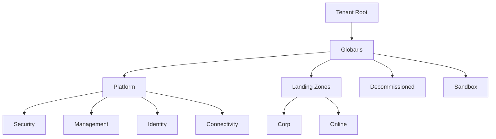
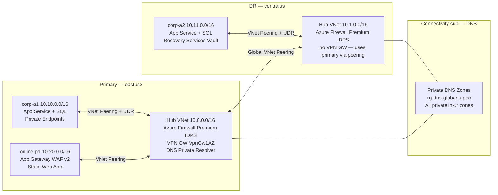
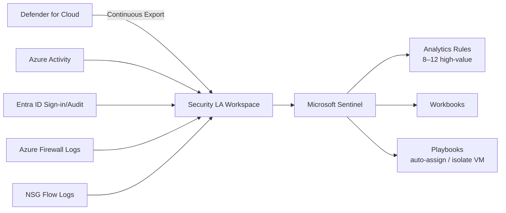

# Architecture

> **Status:** 🚧 Diagrams and detail populated incrementally as sections complete.
> Sections referenced: PROMPT.md §1–13.

---

## Management Group Hierarchy

<!-- Populated: Section 2 -->

---

## Hub & Spoke Network Topology

<!-- Populated: Sections 3, 8, 9 -->

---

## Zero Trust Pillar Mapping

<!-- Populated: Section 5 -->

| Pillar | Control | Implementation |
|--------|---------|----------------|
| Identity | MFA for all admins | Conditional Access policy |
| Identity | No legacy auth | CA block policy |
| Identity | PIM for privileged roles | eligible-only, 8h max |
| Devices | Compliant device required | CA — Azure portal + mgmt API |
| Network | Private Endpoints only | Azure Policy Deny on Landing Zones MG |
| Network | Firewall inspection | Azure Firewall Premium TLS inspection |
| Data | CMK on state storage | Customer-managed key on SA |
| Applications | WAF in front of online workloads | App Gateway WAF v2 |
| Infrastructure | JIT VM access | Defender for Cloud JIT |

---

## DR / Business Continuity

<!-- Populated: Section 3 -->

### RTO / RPO Targets

| Target | RTO | RPO | Mechanism | Status |
|--------|-----|-----|-----------|--------|
| Synthetic workload VMs (corp-a1) | 4 hours | 15 min | Azure Site Recovery — RSV in corp-a2 | RSV deployed; ASR enrollment in Section 13 |
| SQL Database (corp-a1 → corp-a2) | 1 hour | 5 min | Active Geo-Replication via `creation_source_database_id` | Deferred to Section 12 (both servers must exist first) |
| App Service (corp-a1 → corp-a2) | 30 min | Near-zero | Manual traffic manager cutover; corp-a2 App Service pre-warmed | corp-a2 App Service deployed |
| FinOps archive data | Near-zero | Near-zero | GZRS storage account (finops SA) | GZRS enabled Section 3 |
| Hub network connectivity | 30 min | N/A | Global VNet Peering between hubs; secondary Firewall active | Both hubs peered Section 3 |
| Private DNS resolution | Near-zero | N/A | DNS zones linked to both hub VNets | Section 4 complete |

> RTO/RPO values are POC targets for demo purposes; they are not contractual SLAs.
> Values assume Azure regional infrastructure is available in the DR region.

### DR Topology

- **Primary** (eastus2): Hub VNet + Firewall Premium + VPN Gateway (VpnGw1AZ) + DNS Resolver
- **Secondary** (centralus): Hub VNet + Firewall Premium only — no VPN GW (cost reduction for POC)
- **Hub-to-hub transit**: Global VNet Peering; `allow_gateway_transit = true` on primary side — secondary can use primary VPN GW if needed
- **Firewall policy**: Independent Premium policies in each hub (shared parent policy deferred — see DECISIONS.md ADR-009)
- **Spoke VNets**: All traffic forced through regional Firewall via UDR default route (`0.0.0.0/0 → VirtualAppliance`)

---

## Private DNS Zone Architecture

<!-- Populated: Section 4 -->

- All `privatelink.*` zones hosted in Connectivity subscription
- Zones linked to every hub VNet and spoke VNet
- DNS Private Resolver in each hub forwards to Azure DNS and receives on-premises queries
- No public DNS resolution for PaaS resources in `Corp` landing zone

---

## Defender for Cloud + Sentinel

<!-- Populated: Section 6 -->

---

## Architectural Decision Records

<!-- See DECISIONS.md for full ADR text. Listed here for quick reference. -->

| ADR | Title | Date | Status |
|-----|-------|------|--------|
| ADR-001 | Repo root is the working directory, not a nested alz-poc/ subfolder | 2026-05-04 | Accepted |

---

## ALZ Reference Architecture Fidelity Map

<!-- Gap analysis: this repo vs the Microsoft "Azure landing zone (ALZ) – Hub & Spoke"
     reference diagram, version 2026-04-02. Author: architect gap-analysis, 2026-06-25.
     Legend: ✅ Built · ⚠️ Deviation (by-design, see ADR) · ❌ Gap (not built) · ➖ N/A for POC -->

Compared against the Microsoft **ALZ Hub & Spoke** reference (diagram version **2026-04-02**). This is
the *platform* landing zone; the diagram's application-workload internals are out of scope by design.

| # | Reference element | Status | Where / note |
|---|-------------------|--------|--------------|
| C | MG hierarchy (Platform / Landing Zones / Decommissioned / Sandbox) | ✅ | `platform/management-groups` — `avm-ptn-alz` 0.19.1, custom *Globaris* root (ADR-007) |
| — | Platform **Security** sub — Sentinel + Defender + security LAW | ✅ | `platform/security/{sentinel,defender,diagnostics}.tf` — 7 Defender plans, 10 analytics rules |
| D | Platform **Management** sub — platform LAW, dashboards, Automation, Update Manager | ✅ ⚠️ | `platform/management` — dashboard workbook JSON is a **placeholder** (replace before demo) |
| E | **Connectivity** sub — hub VNet, Firewall Premium (IDPS), VPN GW, DNS Private Resolver | ✅ | `platform/connectivity` — `avm-ptn-alz-connectivity-hub-and-spoke-vnet` 0.17.1 |
| E | — Azure **DDoS Protection** plan | ❌ | Not deployed (cost ~$3k/mo) — POC deviation; flag if faithful posture required |
| E | — **ExpressRoute** circuits / gateway | ⚠️ | `express_route = false` — no on-premises in POC |
| E | — Azure **Bastion** | ✅ | **On-demand** in the primary hub via `var.enable_bastion` (Standard SKU, **default off** = $0 idle; ~+$140/mo while up). Secondary hub stays `bastion = false`. Closed Wave 1 / ADR-015 (G6) |
| B | IAM — MFA, PIM, Conditional Access | ✅ | `platform/identity` — 8 CA policies (report-only), PIM eligible at MG scope |
| B | — Approval workflow / access reviews | ⚠️ | PIM activation only; access-review + approval-flow not modelled |
| — | **Identity** sub — DCs (DC1–3) *or* Entra Domain Services + identity VNet + RSV | ❌ | **`identity_mode = "none"`** (OQ-002) — domain-services infra NOT built |
| F | Landing-zone spokes — VNet, Key Vault, Storage, LAW, private endpoints | ✅ | `landing-zones/{corp-a1,corp-a2,online-p1}` |
| F | — Backup / Site Recovery vault | ✅ | corp-a2 RSV (GeoRedundant, AVM module) ✅; corp-a1 RSV (ZoneRedundant, `avm-res-recoveryservices-vault` 1.1.3) ✅ — closed Wave 2 / ADR-012 |
| F | Separate **Online** LZ subscription (multi-sub A-series) | ⚠️ | Online MG exists; `online-p1` deploys into the **shared** LZ sub (ADR-003) |
| H | **Sandbox** subscription (separate) | ⚠️ | Sandbox MG exists but empty; collapsed into LZ sub (ADR-003) |
| G | **Compliant VM template** — gallery, in-guest DSC, backup policy, extensions, tagging | ❌ | No golden-image / guest-configuration construct anywhere in the repo |
| I | DevOps — Git, pipelines, policy + role definitions | ✅ ⚠️ | `.github/workflows`, `policies/` — Section 10b/c (pre-commit, drift, OPA, PSRule) deferred |
| A | EA / MCA billing hierarchy | ➖ | Billing construct, not IaC |
| — | On-premises AD / hybrid bridge | ➖ | No on-premises in POC |

### Gap checklist (decisions made 2026-06-25 — see ADR-010…016 + `docs/gap-closure-plan.md`)

- [ ] **G1 — Identity subscription domain services** — **CLOSE / Wave 3**. Decision: **Microsoft Entra
  Domain Services** (`identity_mode = "entra-ds"`, Standard, ~$110/mo) + identity VNet (NSG) + RSV, peered
  to primary hub. ADR-010 (reverses OQ-002 → `entra-ds`). Native `azurerm_active_directory_domain_service`
  (no AVM module). One-time manual tenant pre-step (DS SP + `AAD DC Administrators` group).
- [ ] **G2 — Compliant VM template (design area G)** — **CLOSE / Wave 4**. Azure Compute Gallery + image
  definition (`avm-res-compute-gallery` 0.2.0) + built-in machineConfiguration baseline Guest-Config
  initiative + backup policy (reuse G4 RSV) + tag enforcement (reuse ADR-008). ADR-011.
- [ ] **G3 — DDoS Protection plan** — **CONDITIONAL / Wave 5**. Built behind `var.enable_ddos_protection`
  (`avm-res-network-ddosprotectionplan` 0.3.0), **default false** (~$2,944/mo if enabled). ADR-013; user
  decides default via **OQ-009**.
- [x] **G4 — corp-a1 backup vault** — **CLOSED / Wave 2 (2026-06-25)**. RSV in corp-a1
  (`landing-zones/corp-a1/backup.tf`), same module/pin (1.1.3) as corp-a2, ZoneRedundant. ADR-012.
- [ ] **G5 — Separate Sandbox / Online subscriptions** — **CONDITIONAL / Wave 5**. Recommend **keep
  collapsed (deviation)** — it's a subscription-*count* gap, not a capability gap (MG nodes + policy
  inheritance already present). ADR-014; user may override via **OQ-010**.
- [x] **G6 — Azure Bastion** — **CLOSED / Wave 1 (2026-06-27)**. Enabled on the **primary** hub via the
  existing `avm-ptn-alz-connectivity-hub-and-spoke-vnet` 0.17.1 `bastion` flag, deploy-**on-demand** behind
  `var.enable_bastion` (Standard SKU, **default false** = $0 idle; ~+$140/mo while up). Module auto-creates
  the Standard public IP; `AzureBastionSubnet` /26 at `10.0.0.64/26`. Secondary hub unchanged. ADR-015.

### Project backlog (not reference gaps, but open)

- [ ] Section 10b/c — pre-commit, drift detection, OPA/Conftest, PSRule gates
- [ ] Section 11 — documentation deliverables (`SECURITY.md`, `RUNBOOK.md`, `COST.md` are linked from
  README but not yet authored)
- [ ] Section 12 — platform acceptance validation + **OQ-008** (scope OIDC SP down from Owner-at-Tenant-Root)
- [ ] Replace placeholder workbook JSON (Sentinel, Carbon Optimization) before any live demo
- [ ] Housekeeping: this ADR quick-ref table lists only ADR-001 — DECISIONS.md has ADR-001…009
