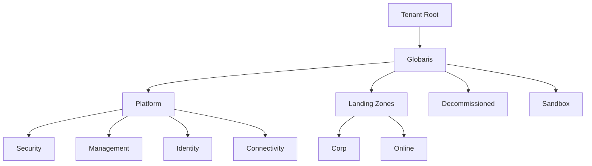
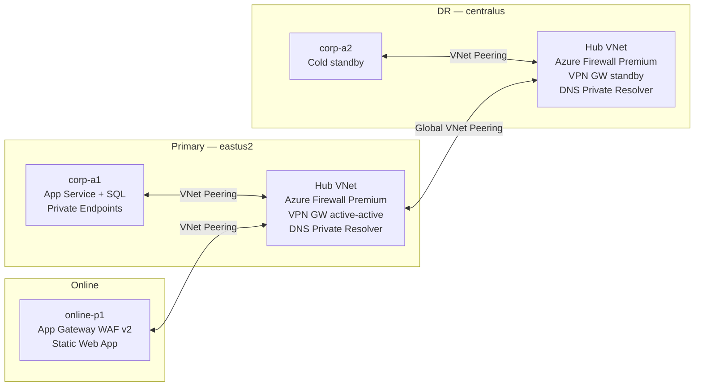
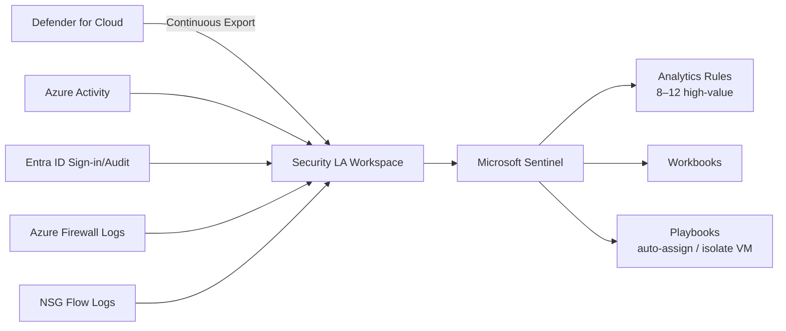

# Architecture

> **Status:** 🚧 Diagrams and detail populated incrementally as sections complete.
> Sections referenced: PROMPT.md §1–13.

---

## Management Group Hierarchy

<!-- Populated: Section 2 -->

---

## Hub & Spoke Network Topology

<!-- Populated: Sections 3, 8, 9 -->

---

## Zero Trust Pillar Mapping

<!-- Populated: Section 5 -->

| Pillar | Control | Implementation |
|--------|---------|----------------|
| Identity | MFA for all admins | Conditional Access policy |
| Identity | No legacy auth | CA block policy |
| Identity | PIM for privileged roles | eligible-only, 8h max |
| Devices | Compliant device required | CA — Azure portal + mgmt API |
| Network | Private Endpoints only | Azure Policy Deny on Landing Zones MG |
| Network | Firewall inspection | Azure Firewall Premium TLS inspection |
| Data | CMK on state storage | Customer-managed key on SA |
| Applications | WAF in front of online workloads | App Gateway WAF v2 |
| Infrastructure | JIT VM access | Defender for Cloud JIT |

---

## DR / Business Continuity

<!-- Populated: Section 3 -->

| Target | RTO | RPO | Mechanism |
|--------|-----|-----|-----------|
| corp-a1 VMs | 4 hours | 15 minutes | Azure Site Recovery (ASR) |
| SQL Database | 1 hour | 5 minutes | Active Geo-Replication to corp-a2 |
| Platform state | Near-zero | Near-zero | GZRS storage account |
| Hub connectivity | 30 minutes | N/A | VPN GW standby in centralus |

> RTO/RPO values are targets for the POC demo; they are not contractual SLAs.

---

## Private DNS Zone Architecture

<!-- Populated: Section 4 -->

- All `privatelink.*` zones hosted in Connectivity subscription
- Zones linked to every hub VNet and spoke VNet
- DNS Private Resolver in each hub forwards to Azure DNS and receives on-premises queries
- No public DNS resolution for PaaS resources in `Corp` landing zone

---

## Defender for Cloud + Sentinel

<!-- Populated: Section 6 -->

---

## Architectural Decision Records

<!-- See DECISIONS.md for full ADR text. Listed here for quick reference. -->

| ADR | Title | Date | Status |
|-----|-------|------|--------|
| ADR-001 | Repo root is the working directory, not a nested alz-poc/ subfolder | 2026-05-04 | Accepted |
