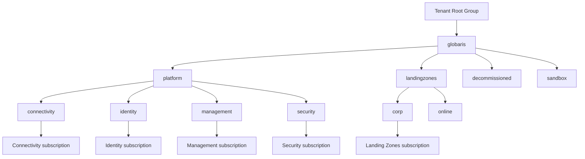
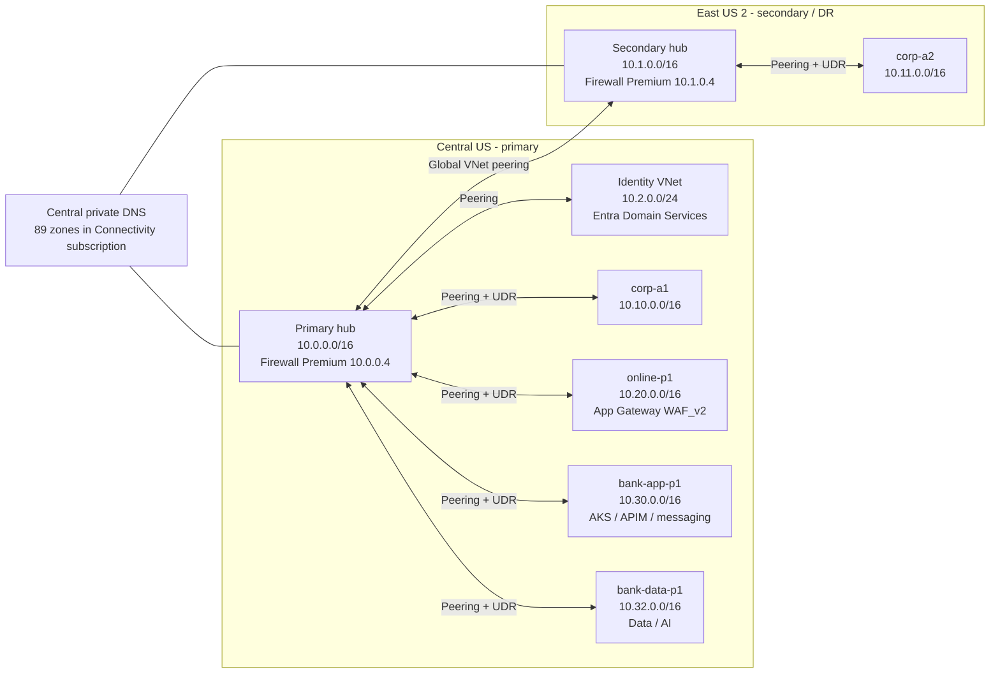
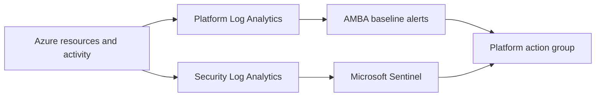
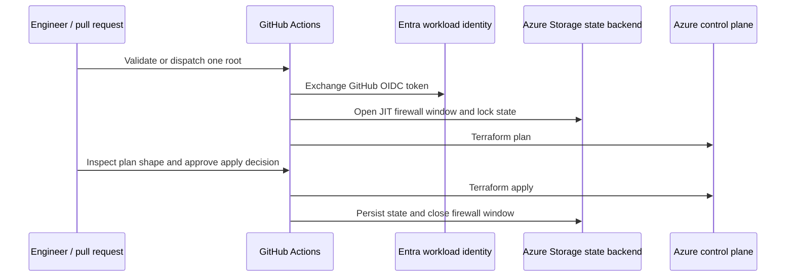

# Architecture

This document describes the Azure architecture implemented by this repository and the complete estate that
was live-verified on 2026-08-01. The estate is currently greenfield after a verified teardown; the deployed
shape remains the regression baseline in [`docs/estate-bom.md`](docs/estate-bom.md).

## 1. Architecture principles

1. **Platform and workload separation.** Connectivity, identity, management, and security have dedicated
   subscriptions; workload spokes share a Landing Zones subscription for POC cost and quota reasons.
2. **Policy inheritance over per-resource convention.** Management groups provide the control boundary for
   policy, monitoring, security posture, and subscription placement.
3. **Private-by-default workload networking.** Workload spokes route through regional firewalls; private
   endpoints and central private DNS are used where the selected service and POC gate permit them.
4. **Infrastructure as code is the control plane.** Terraform composition roots, pinned AVM modules, remote
   state, plan review, and GitHub Actions OIDC replace portal-built infrastructure.
5. **POC and production targets are explicitly different.** Expensive, quota-constrained, tenant-gated, or
   operationally immature features are flag-gated or design-only and recorded as such.
6. **Deletion and recovery are designed capabilities.** Teardown, soft-delete handling, cross-root
   attachments, and state reset are part of the architecture.

## 2. Evidence states

| State | Architectural interpretation |
| --- | --- |
| Repository capability | The code can create the roots and feature-gated resources documented here. |
| Proven deployment | The 2026-08-01 BOM is the authoritative live snapshot: 404 top-level ARM resources, 30 comparable resource groups, 12 management groups including Tenant Root, and 8 connected peerings. |
| Current Azure state | Verified greenfield after run `30785098012`; the bootstrap backend remains and the managed root states are canonical-empty. |

This distinction prevents a destroyed POC from being described as “currently deployed” while preserving the
fact that the architecture was built and verified.

## 3. Management-group and subscription topology

The August 1 live verification found:

- 12 management groups including Tenant Root;
- 147 policy assignments directly at management-group scopes;
- 6 additional subscription-scope assignments;
- 292 custom policy definitions and 59 custom initiatives at `globaris`; and
- 29 RBAC assignments directly at `globaris`, including two known Owner assignments tracked as privilege debt.

All five workload spokes are hosted in the single Landing Zones subscription. Because a subscription can have
only one management-group parent, it sits under `corp`. The `online` management group proves the archetype
shape but does not govern a separate subscription in this POC.

## 4. Regional and network topology

Central US is primary; East US 2 is secondary/DR. ADR-069 reversed the original suggestion after multiple
East US 2 capacity constraints affected AI Search, Fabric, compute, SQL, and App Service choices.

### 4.1 Proven network properties

- Both Azure Firewall instances were Premium, zone-redundant across zones 1, 2, and 3.
- Primary and secondary firewall private IPs were fixed at `10.0.0.4` and `10.1.0.4`.
- All five spoke default routes pointed to the appropriate regional firewall.
- All eight peerings were `Connected`.
- The online WAF policy was enabled in Prevention mode.
- Private DNS was centralized in the Connectivity subscription and linked to hubs and workload VNets.
- VNet flow logs and Traffic Analytics were used on supported spokes; VNet diagnostic settings remain a
  documented hardening gap.

### 4.2 Gated connectivity features

The following are represented in code or design but were absent from the August 1 BOM:

- DDoS Network Protection;
- VPN Gateway;
- DNS Private Resolver;
- Azure Bastion; and
- ExpressRoute/on-premises connectivity.

The firewalls were re-enabled for the banking build and were time-boxed because they dominate idle cost.

## 5. Platform layers

### 5.1 Governance layer

`platform/management-groups` uses `Azure/avm-ptn-alz/azurerm` version `0.19.1` with the ALZ provider and a
pinned ALZ library reference. The layer creates the hierarchy, subscription placement, policy definitions,
initiatives, assignments, remediation identities, allowed-location guardrails, and AMBA-related assignments.

The allowed-location policy is enforced at the `globaris` root for nine continental US regions excluding
Azure canary/staging regions. It intentionally excludes `global` resources through the built-in policy rule.

### 5.2 Management and FinOps layer

`platform/management` provides:

- the central platform Log Analytics workspace with 90-day retention;
- an Automation Account and platform action group;
- subscription and management-group budgets;
- cost exports and anomaly-notification plumbing;
- platform and carbon-optimization workbooks; and
- the supporting resources for AMBA when the O&M phase is enabled.

The proven POC configured five subscription budgets at $200 each and management-group budgets, with alerts at
50, 75, 90, and 100 percent. Budget start dates are calendar-sensitive; a stale month caused a real rebuild
failure and is tracked as a required preflight control.

### 5.3 Security layer

`platform/security` provides a dedicated security Log Analytics workspace, Microsoft Sentinel onboarding,
analytics rules and workbooks, Defender for Cloud pricing configuration, subscription diagnostics, regulatory
compliance views, and a security Key Vault.

The August 1 snapshot verified 11 Defender plans at Standard in the Security subscription. Defender coverage
was not extended to all five subscriptions; that is a documented hardening decision, not an estate-wide claim.
See [`SECURITY.md`](SECURITY.md).

### 5.4 Identity layer

`platform/identity` provides:

- a dedicated `10.2.0.0/24` identity VNet;
- Microsoft Entra Domain Services Standard;
- a Recovery Services vault;
- eight Conditional Access policies in report-only mode; and
- code for PIM and privileged-group inputs.

The Entra DS build produced important operational lessons: a custom deny-all NSG rule broke the platform's
required inbound behavior, and its multi-hour create exceeded the lifetime of a single OIDC assertion. The
current operator procedure uses a two-pass identity deployment with refresh-enabled OIDC and separates the
long ARM operation from directory changes.

### 5.5 Connectivity layer

`platform/connectivity` uses the AVM ALZ hub-and-spoke pattern module version `0.17.1` and the private DNS
pattern module version `0.23.1`. It owns the two hubs, regional firewall policies, global hub peering, central
private DNS zones, diagnostics, and workload-specific firewall rule collection groups.

Independent regional firewall policies were selected for the POC rather than a shared parent policy. This
keeps regional rollout and troubleshooting isolated but duplicates policy management.

## 6. Workload landing zones

| Root | Proven role | Key implementation | Deliberate boundary |
| --- | --- | --- | --- |
| `corp-a1` | Primary corporate network landing zone | VNet, subnets, NSG, UDR, flow logs, ZRS Recovery Services vault | SQL and App Service were gated off by subscription offer caps. |
| `corp-a2` | Secondary corporate network landing zone | VNet, UDR, flow logs, GRS Recovery Services vault with cross-region restore | Cold network/backup pattern, not a running application failover target. |
| `online-p1` | Internet-facing pattern | Application Gateway WAF_v2, WAF policy in Prevention, Static Web App | Not isolated in a separate Online subscription. |
| `bank-app-p1` | Banking application platform | Private AKS, Premium ACR, APIM Developer, Event Hubs Standard, Service Bus Premium, private endpoints | Single-region POC; no user node pool or geo-replication. |
| `bank-data-p1` | Banking data and AI platform | Databricks Premium VNet injection/NPIP, ADLS Gen2, Fabric F2, Foundry AIServices + model, AI Search Basic, private endpoints | No Databricks clusters/jobs, Fabric artifacts, or full CMK implementation. |

The banking extension deliberately chose current-generation services. Microsoft Fabric and Databricks were
used instead of anchoring a new platform on Synapse. Microsoft Foundry was deployed using the AIServices
resource shape rather than the classic hub model.

## 7. Observability and operations

The architecture separates platform and security telemetry:

Diagnostic settings were implemented for major banking resources, while VNet diagnostics remain missing.
AMBA and Service/Resource Health were implemented as an operations capability, but the current greenfield
configuration keeps `enable_om_phase1 = false` until the later rebuild pass. Sentinel automation playbooks and
the synthetic incident generator were not part of the proven live estate.

## 8. Delivery and state architecture

Important design facts:

- Bootstrap state is local and never committed; it creates the remote backend and federated identity.
- Each root has a separate state key and pinned dependency lock file.
- Full-estate apply is sequential single-target only; `target=all` apply is blocked.
- Cross-root outputs are passed through deterministic repository variables/secrets rather than implicit
  remote-state coupling.
- Identity and the AKS-to-ACR binding use deliberate two-pass operations.
- A plan scan treats unexpected replacement or destroy as a stop condition.
- Branch protection exists, but the claimed local review hook and GitHub environment reviewer behavior have
  known enforcement limitations. Documentation does not treat them as proven controls.

## 9. Resilience and recovery objectives

The original POC contained design targets, but the August 1 build did not deploy replicated application or
database workloads across both regions. The table distinguishes implemented mechanisms from targets.

| Capability | RTO target | RPO target | Proven mechanism | Status |
| --- | --- | --- | --- | --- |
| Regional network path | 30 minutes | N/A | Two hubs, two active firewalls, global peering, regional spoke UDRs | Topology proven; failover drill not load-tested. |
| Corporate workload recovery | 4 hours | 15 minutes | Secondary spoke and Recovery Services vaults | Vault/topology proven; workload replication not configured. |
| Corporate SQL | 1 hour | 5 minutes | Intended active geo-replication | SQL gated off; target not implemented. |
| Corporate App Service | 30 minutes | Near-zero | Intended pre-warmed secondary and traffic cutover | App Service gated off; target not implemented. |
| Banking application platform | Not established for POC | Not established for POC | Single-region AKS/APIM/messaging POC | Multi-region design deferred; production targets require business service objectives. |
| Banking data platform | Not established for POC | Not established for POC | ZRS lake storage plus single-region managed services | Regional DR and CMK deferred; production targets require data-loss and recovery objectives. |
| IaC recovery | Rebuild measured in hours | Last successful state write | Separate state keys, sequential rebuild runbook, BOM and plan bars | Full build and multiple full teardowns proven. |

These are engineering targets, not contractual SLAs.

## 10. Security and Zero Trust summary

| Pillar | Implemented evidence | Mode/boundary |
| --- | --- | --- |
| Identity | OIDC workload identity, eight CA policies, Entra DS isolation | OIDC enforced; CA report-only; PIM not proven active. |
| Network | Firewalls, forced routing, WAF, private endpoints and DNS | Enforced where deployed; DDoS plan and resolver absent. |
| Applications | Private AKS, Entra-only cluster auth, internal APIM pattern, WAF edge | Single-region and POC SKUs. |
| Data | ADLS/Foundry/Search private access, AAD-only messaging, isolated security workspace | CMK design not implemented; some Key Vault/storage hardening remains. |
| Visibility | Log Analytics, Sentinel, Defender configuration, AMBA capability | Defender proven only in Security subscription; some connectors tenant-gated. |
| Governance | ALZ policies, allowed locations, budgets, tag policies, ADRs | Mix of Deny, Modify, DINE, Audit and exemptions; see `SECURITY.md`. |

## 11. Major architectural decisions

| ADR | Decision | Tradeoff demonstrated |
| --- | --- | --- |
| 003 | Four platform subscriptions plus one shared Landing Zones subscription | Preserved platform/workload boundaries while accepting a shared workload subscription. |
| 009 | Independent regional firewall policies | Regional isolation over centralized reuse. |
| 021 | Scoped CI role model | Least privilege was designed, but live Owner drift remained and was documented. |
| 038 | Consume AVM directly in composition roots | Avoided an unused wrapper abstraction. |
| 042/044 | Flag-gate and time-box paid hub appliances | Cost control without deleting capability. |
| 048/051 | Databricks/Fabric and Foundry/Search platform choices | Current service direction and regional capacity over stale or unavailable defaults. |
| 055 | Refresh-enabled OIDC plus two-pass identity apply | Durable handling for multi-hour managed-domain provisioning. |
| 060 | Sequential single-target full rebuild | Reliability and state-firewall safety over parallel speed. |
| 063-073 | Teardown, recovery keys, ownership, and region controls | Operational failure evidence drove the architecture, not just greenfield design. |
| 069 | Central US primary, East US 2 DR | Capacity evidence over an unexamined prompt default. |
| 070 | Terraform owns diagnostics and PE DNS zone groups | Prevented DINE/Terraform dual-writer collisions. |
| 074 | Enforced continental-US allowed locations | Closed a preventive-governance gap found through live inspection. |

Full rationale and amendments are in [`DECISIONS.md`](DECISIONS.md).

## 12. Fidelity and known gaps

| Area | Status | Evidence or boundary |
| --- | --- | --- |
| ALZ management groups and policy engine | Built and proven | 12-MG topology, 147 MG-scope assignments, 292 definitions, 59 initiatives. |
| Multi-region hub-and-spoke | Built and proven | Two hubs, two firewalls, five spokes, eight connected peerings. |
| Central private DNS | Built and proven | 89-zone inventory in Connectivity subscription. |
| Identity platform | Built and proven | Entra DS and eight report-only CA policies. |
| Security operations | Built with qualifications | Sentinel and Defender configuration; tenant connectors and automation partly gated. |
| Banking application/data/AI platforms | Built and proven | BOM verified AKS, ACR, APIM, messaging, Databricks, ADLS, Fabric, Foundry and Search. |
| Operations-monitoring target | Implemented capability, staged | AMBA pass proven; flag reset for greenfield rebuild sequence. |
| DDoS, VPN, DNS Resolver, Bastion | Gated/absent in proven BOM | Cost and scope decisions. |
| Corporate SQL/App Service | Gated/absent | Subscription offer caps. |
| CMK for banking data tier | Designed, not implemented | ADR-053 and B9 design only. |
| VNet diagnostic settings | Missing | Hardening plan item. |
| Production-grade multi-region banking workloads | Designed/deferred | POC uses single-region service instances. |
| Current rebuild | Held | Sentinel scheduled-rule 401 investigation requires directory-role verification. |

## 13. Authoritative evidence

- [`docs/estate-bom.md`](docs/estate-bom.md): live-verified August 1 estate.
- [`docs/2026-07-22-full-estate-rebuild-runbook.md`](docs/2026-07-22-full-estate-rebuild-runbook.md): proven build procedure and plan bars.
- [`docs/worklog/2026-08-03.md`](docs/worklog/2026-08-03.md): current greenfield state and rebuild hold.
- [`docs/advisor-remediation-plan.md`](docs/advisor-remediation-plan.md): post-build gaps and hardening order.
- [`docs/acceptance-validation.md`](docs/acceptance-validation.md): original acceptance results and explicit misses.
- [`DECISIONS.md`](DECISIONS.md): full ADR history.
