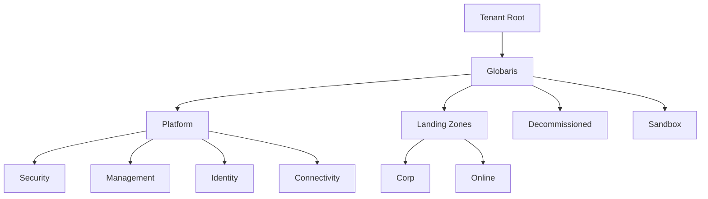
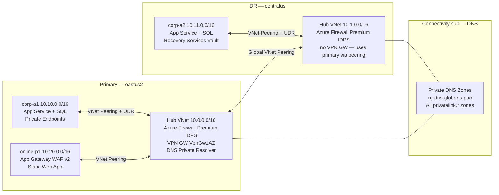
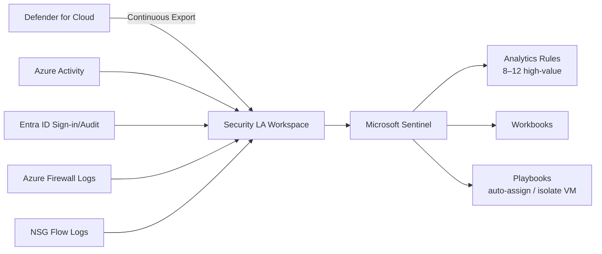

# Architecture

> **Status:** 🚧 Diagrams and detail populated incrementally as sections complete.
> Sections referenced: PROMPT.md §1–13.

---

## Management Group Hierarchy

<!-- Populated: Section 2 -->

---

## Hub & Spoke Network Topology

<!-- Populated: Sections 3, 8, 9 -->

---

## Zero Trust Pillar Mapping

<!-- Populated: Section 5 -->

| Pillar | Control | Implementation |
|--------|---------|----------------|
| Identity | MFA for all admins | Conditional Access policy |
| Identity | No legacy auth | CA block policy |
| Identity | PIM for privileged roles | eligible-only, 8h max |
| Devices | Compliant device required | CA — Azure portal + mgmt API |
| Network | Private Endpoints only | Azure Policy Deny on Landing Zones MG |
| Network | Firewall inspection | Azure Firewall Premium TLS inspection |
| Data | CMK on state storage | Customer-managed key on SA |
| Applications | WAF in front of online workloads | App Gateway WAF v2 |
| Infrastructure | JIT VM access | Defender for Cloud JIT |

---

## DR / Business Continuity

<!-- Populated: Section 3 -->

### RTO / RPO Targets

| Target | RTO | RPO | Mechanism | Status |
|--------|-----|-----|-----------|--------|
| Synthetic workload VMs (corp-a1) | 4 hours | 15 min | Azure Site Recovery — RSV in corp-a2 | RSV deployed; ASR enrollment in Section 13 |
| SQL Database (corp-a1 → corp-a2) | 1 hour | 5 min | Active Geo-Replication via `creation_source_database_id` | Deferred to Section 12 (both servers must exist first) |
| App Service (corp-a1 → corp-a2) | 30 min | Near-zero | Manual traffic manager cutover; corp-a2 App Service pre-warmed | corp-a2 App Service deployed |
| FinOps archive data | Near-zero | Near-zero | GZRS storage account (finops SA) | GZRS enabled Section 3 |
| Hub network connectivity | 30 min | N/A | Global VNet Peering between hubs; secondary Firewall active | Both hubs peered Section 3 |
| Private DNS resolution | Near-zero | N/A | DNS zones linked to both hub VNets | Section 4 complete |

> RTO/RPO values are POC targets for demo purposes; they are not contractual SLAs.
> Values assume Azure regional infrastructure is available in the DR region.

### DR Topology

- **Primary** (eastus2): Hub VNet + Firewall Premium + VPN Gateway (VpnGw1AZ) + DNS Resolver
- **Secondary** (centralus): Hub VNet + Firewall Premium only — no VPN GW (cost reduction for POC)
- **Hub-to-hub transit**: Global VNet Peering; `allow_gateway_transit = true` on primary side — secondary can use primary VPN GW if needed
- **Firewall policy**: Independent Premium policies in each hub (shared parent policy deferred — see DECISIONS.md ADR-009)
- **Spoke VNets**: All traffic forced through regional Firewall via UDR default route (`0.0.0.0/0 → VirtualAppliance`)

---

## Private DNS Zone Architecture

<!-- Populated: Section 4 -->

- All `privatelink.*` zones hosted in Connectivity subscription
- Zones linked to every hub VNet and spoke VNet
- DNS Private Resolver in each hub forwards to Azure DNS and receives on-premises queries
- No public DNS resolution for PaaS resources in `Corp` landing zone

---

## Defender for Cloud + Sentinel

<!-- Populated: Section 6 -->

---

## Architectural Decision Records

<!-- See DECISIONS.md for full ADR text. Listed here for quick reference. -->

| ADR | Title | Date | Status |
|-----|-------|------|--------|
| ADR-001 | Repo root is the working directory, not a nested alz-poc/ subfolder | 2026-05-04 | Accepted |
