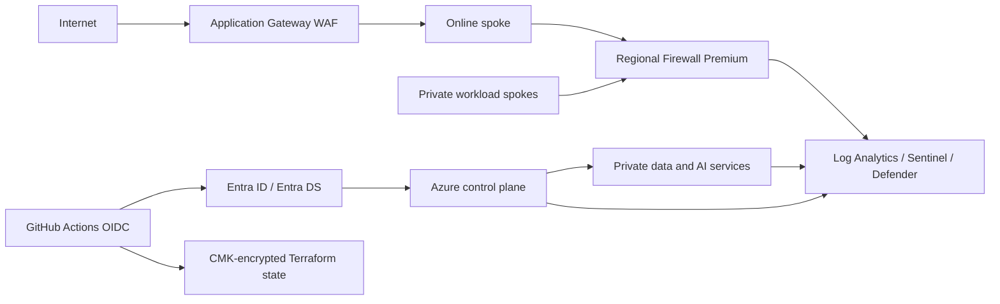

# Security Architecture, Threat Model, and Compliance Posture

This document describes the security controls implemented by the repository and proven in the complete
2026-08-01 estate. The estate is currently greenfield after a verified teardown. Controls are classified as
enforced, audit, report-only, detection-only, gated, designed, or missing so that a POC is not presented as a
production-certified environment.

## 1. Security posture at a glance

| Domain | Proven implementation | Qualification |
| --- | --- | --- |
| Governance | ALZ hierarchy, policy inheritance, nine-region continental-US Deny, tag/budget policies, 147 MG-scope assignments | Policy effects include Deny, Modify, DINE, Audit and scoped exemptions; they are not uniformly enforcing. |
| Identity | OIDC workload identity, Entra DS, eight Conditional Access policies | OIDC enforced; CA report-only; PIM code exists but eligible assignment posture was not proven live. |
| Network | Two Firewall Premium instances, forced UDRs, WAF Prevention, private endpoints and DNS | DDoS plan, TLS inspection, VPN, DNS Resolver and Bastion were absent from the August 1 BOM. |
| Application | Private AKS, Entra-only auth, internal APIM pattern, AAD-only messaging, WAF edge | Single-region POC SKUs and limited scaling. |
| Data/AI | ADLS, Foundry and Search private endpoints; public access disabled on Foundry/Search | Banking CMK design was not implemented; some Key Vault/storage network controls remain open. |
| Detection | Log Analytics, Microsoft Sentinel, Defender plans, diagnostics, AMBA capability | Defender Standard was proven only in the Security subscription; several tenant connectors remained gated. |
| Delivery | GitHub Actions OIDC, remote state locking/CMK, plan-scan, branch protection | Environment reviewers were not enforced; CI Owner drift and local hook fail-open behavior remain known debt. |

## 2. Trust boundaries

The principal boundaries are:

1. internet to the online workload edge;
2. workload spokes to regional hubs and shared platform services;
3. GitHub Actions to Entra workload identity and Azure control planes;
4. Terraform state to the identity authorized to read/write it;
5. Entra tenant and managed-domain operations to Azure resources; and
6. data/AI service private endpoints to central DNS and monitoring.

## 3. Threat model

### 3.1 Identity and privileged access

| Threat | Control | Mode | Residual risk |
| --- | --- | --- | --- |
| Credential theft or legacy authentication | CA policies for admin MFA, legacy-auth block, risk, compliant devices and sign-in frequency | **Report-only** | Policies observe impact but do not block. Enforce only after break-glass validation. |
| Long-lived automation credential theft | GitHub OIDC federated credential; no Azure client secret | **Enforced** | Repository/ref/environment trust and CI permissions become the credential boundary. |
| Standing privilege | Scoped RBAC design and PIM inputs | **Partly designed** | Two Owner grants were still present at `globaris` in the BOM. OQ-061 tracks reconciliation. |
| Directory role loss or drift | Explicit tenant-role preflight and two-pass identity runbook | **Operational control** | The current rebuild is held because Sentinel writes returned 401 and the Security Administrator role state has not been confirmed. |
| Managed-domain compromise or failure | Entra DS isolated in a dedicated VNet; required Azure NSG behavior retained | **Enforced network isolation** | A custom deny-all previously broke domain controller replication, proving managed services require documented platform traffic. |

Eight Conditional Access policies were implemented in
`enabledForReportingButNotEnforced`. A production transition requires:

1. two break-glass accounts or an equivalent emergency-access design;
2. explicit exclusions in every policy;
3. report-only telemetry review;
4. staged enforcement by policy; and
5. rollback and lockout testing.

### 3.2 CI/CD and management plane

| Threat | Control | Mode | Residual risk |
| --- | --- | --- | --- |
| State disclosure or tampering | Dedicated Storage Account, shared-key disabled, Entra data-plane RBAC, CMK, blob leases/versioning | **Enforced** | Bootstrap Key Vault public network access is enabled; state access still depends on RBAC and state-SA network rules. |
| Unauthorized apply | Manual workflow dispatch, branch protection, plan-before-apply | **Partly enforced** | GitHub environment reviewer protection was unavailable on the current plan; environments exist but are ungated. |
| Unreviewed commit | Reviewer role and stamped-tree process | **Process control** | The local hook can fail open and cannot prove worktree review. Cite a reviewer verdict/tree hash, not a successful commit. |
| Concurrent state mutation | Single-root sequential applies and per-run JIT state-SA firewall window | **Enforced in workflow** | `target=all` apply is blocked; overlapping single-root runs are an operator stop condition. |
| Multi-hour token expiry | Refresh-enabled OIDC plus two-pass identity deployment | **Implemented** | External Graph/directory operations still depend on tenant roles and provider behavior. |
| Destructive recovery masking drift | Plan scan, full teardown/restart rule, independent verification | **Operational control** | Recovery is slower, but prevents repair-forward from hiding a broken greenfield path. |

The bootstrap role design in ADR-021 is less broad than Tenant Root Owner, but the live BOM still found known
Owner drift. This is a security debt item, not a “least privilege complete” claim.

### 3.3 Internet edge and network plane

| Threat | Control | Mode | Residual risk |
| --- | --- | --- | --- |
| Web exploitation | Application Gateway WAF_v2 with policy in Prevention | **Enforced** | POC backend and scale do not represent a production online service. |
| Lateral movement/egress bypass | Spoke UDRs to regional Firewall Premium, fixed next hops, connected peerings | **Enforced routing** | Firewall compromise/misconfiguration is a shared regional risk; rules require disciplined ownership. |
| Known malicious traffic | Firewall Premium IDPS | **Detection/alert posture** | TLS inspection was not wired and automatic blocking was not claimed. |
| Volumetric attack | Azure platform DDoS Basic plus WAF/firewall capacity | **Baseline only** | DDoS Network Protection was absent for cost reasons. |
| Public PaaS exposure | Private endpoints, disabled public access where implemented, policy guardrails | **Mixed** | Banking data/AI paths used PEs; platform Key Vaults and some storage/network paths remained hardening gaps. |
| Data residency drift | Allowed Locations and Allowed Locations for Resource Groups at `globaris` | **Deny** | Nine approved continental-US regions intentionally permit future moves beyond the two deployed regions. |

All eight peerings were connected, five spokes routed to regional firewalls, and the WAF was in Prevention in
the August 1 snapshot. VNet flow logs existed, but VNet diagnostic settings did not; the two telemetry types are
not substitutes.

### 3.4 Application, data, and AI plane

| Surface | Proven control | Residual risk |
| --- | --- | --- |
| AKS | Private cluster, local accounts disabled, Entra authentication/Azure RBAC, workload identity/OIDC, Premium ACR private access | One system node pool, no production autoscaling/DR, and kubelet ACR binding requires a second pass. |
| APIM | Internal VNet mode design, forced routing and dedicated egress rule set | Developer tier; platform surface reported public network access enabled as an SKU/management behavior; dependency health required follow-up. |
| Messaging | Service Bus Premium and Event Hubs Standard with private endpoints and local auth disabled | Single region, no geo-replication; Defender for APIs was not enabled. |
| ADLS/Databricks | ADLS Gen2 private blob/dfs endpoints; Databricks VNet injection and no-public-IP secure cluster connectivity | Data-tier CMK was designed but not built; Databricks compute/jobs and Unity Catalog were out of scope. |
| Foundry/Search | Foundry AIServices and AI Search public access disabled with private endpoints | Model/data governance beyond infrastructure, prompt safety, evaluation and production RAI operations were out of scope. |
| Key Vault/storage | Soft delete/purge protection where configured; RBAC; TLS | Advisor found public-network and diagnostic/soft-delete gaps across parts of the estate. |

## 4. Zero Trust mapping

| Pillar | Control | State |
| --- | --- | --- |
| Identity | OIDC workload identity | Enforced. |
| Identity | Conditional Access policy set | Report-only. |
| Identity | PIM/eligible access | Code/design present; live posture not proven. |
| Devices | Compliant/hybrid-joined device condition | Report-only CA policy. |
| Network | Firewall forced routing | Enforced in deployed routes. |
| Network | WAF and private endpoints | Enforced where deployed; not universal. |
| Applications | Entra-only AKS, AAD-only messaging, local auth disabled | Enforced for those platforms. |
| Data | Private ADLS/Foundry/Search access | Enforced for those service paths. |
| Visibility | Sentinel, Defender, diagnostics, AMBA | Implemented with subscription and connector limitations. |
| Governance | Management-group policy, region Deny, budgets and tags | Enforced/audit/modify depending on assignment. |

“Verify explicitly” is represented by short-lived identity, plan inspection, live post-apply checks, and policy
evidence. “Use least privilege” is an incomplete journey because of known Owner drift. “Assume breach” is
represented by central telemetry, WAF/firewall controls, and teardown/recovery design, but not by a mature SOC
or tested automated containment.

## 5. Defender for Cloud and Microsoft Sentinel

### 5.1 Defender scope

The August 1 BOM verified these plans at Standard in the **Security subscription**:

- VirtualMachines;
- SqlServers;
- AppServices;
- StorageAccounts;
- SqlServerVirtualMachines;
- OpenSourceRelationalDatabases;
- Containers;
- CloudPosture;
- AI;
- Discovery; and
- FoundationalCspm.

This was not estate-wide coverage. The Security Terraform root owns one subscription, and the Defender pricing
resources were not iterated across all five. Azure Advisor therefore raised coverage and cost decisions for the
other subscriptions. Do not describe the implementation as “Defender enabled across the estate.”

### 5.2 Sentinel scope

The Security workspace was onboarded to Sentinel with scheduled analytics, Microsoft Defender incident
integration, workbooks, and diagnostic inputs. Several tenant-scoped connectors and UEBA were feature-gated
behind directory roles/licensing. The synthetic signal layer and Logic App playbooks were not part of the
proven estate.

The current rebuild hold is a 401 on nine Sentinel scheduled-rule writes at Step 3. Six technical hypotheses
were refuted; the remaining directory-role check is documented in the latest worklog.

## 6. Compliance posture

### 6.1 Implemented governance evidence

- Microsoft Cloud Adoption Framework landing-zone hierarchy and Azure Policy engine.
- NIST SP 800-53 Rev. 5 and CIS Microsoft Azure Foundations Benchmark 2.0.0 initiatives in audit posture.
- Region Deny controls at the organization root.
- Tag governance and cost budgets.
- Central logging and security-workspace separation.
- ADRs, pre-clearance records, live BOM, teardown certification, and acceptance reports.

Audit initiatives provide visibility; they do not certify compliance. PCI DSS/SOC 2 banking initiatives and
the complete B9 CMK/security wave were designed but not implemented.

### 6.2 Acceptance evidence

The original Section 12 validation intentionally did not claim a clean pass:

- blended Secure Score was 56.8 percent at the validation snapshot, below the 75 percent criterion;
- private-endpoint coverage was structurally incomplete at that time;
- no Logic App playbooks existed;
- cost-forecast accuracy was not yet measurable; and
- Key Vault public-network posture was identified as a finding.

Later banking deployment added real private endpoints and new platforms, but it did not retroactively turn the
original acceptance report into a pass. See [`docs/acceptance-validation.md`](docs/acceptance-validation.md).

## 7. Security control classification

| Control | Classification |
| --- | --- |
| Allowed locations | Enforced Deny. |
| Forced routes to firewall | Enforced. |
| WAF Prevention | Enforced while deployed. |
| Private endpoints | Enforced for selected banking services; not universal. |
| Conditional Access | Report-only. |
| NIST/CIS initiatives | Audit/evidence, not certification. |
| Firewall IDPS | Detection/alert posture. |
| Sentinel analytics | Detection; source availability varies by connector. |
| Defender | Standard in Security subscription only. |
| PIM | Designed/code present; live eligibility not proven. |
| Environment reviewer approval | Not enforced on the active GitHub plan. |
| State CMK | Implemented. |
| Banking data-tier CMK | Designed, not implemented. |
| DDoS Network Protection | Gated/absent. |
| Automated SOAR playbooks | Missing/deferred. |

## 8. Hardening priorities

The post-build hardening order is documented in
[`docs/advisor-remediation-plan.md`](docs/advisor-remediation-plan.md). Highest-value actions are:

1. resolve the Sentinel 401 role/authentication cause before rebuilding;
2. reconcile CI Owner assignments to the approved scoped model;
3. enforce Conditional Access only after break-glass and report-only review;
4. extend Defender decisions across all five subscriptions with explicit cost approval;
5. close Key Vault public-network and diagnostic gaps;
6. add VNet diagnostic settings and storage soft-delete controls;
7. implement the resolved data-tier CMK design with a Databricks replacement stop condition;
8. re-verify Service Health/AMBA and APIM dependency health on a live estate;
9. add tested incident automation where business processes and ownership exist; and
10. define production DR, scaling, RAI, and data-governance controls for banking workloads.

## 9. Security-relevant decision record

| ADR | Subject |
| --- | --- |
| 021 | CI OIDC service-principal scope-down model. |
| 025 | Just-in-time state Storage Account firewall behavior. |
| 028-035 | Entra DS policy exemption, recovery, CA gating, Sentinel/Defender deployment fixes. |
| 043-053 | Banking AKS, messaging, APIM, data, AI and security design decisions. |
| 055 | Refresh-enabled OIDC and two-pass identity deployment. |
| 058 | Independent teardown certification. |
| 060 | Sequential single-target deployment. |
| 063-073 | Extension-resource ownership, soft-delete recovery, teardown, and state-reset controls. |
| 069 | Region role reversal based on capacity evidence. |
| 070 | Terraform sole ownership of diagnostics and private-endpoint DNS zone groups. |
| 074 | Enforced continental-US location restrictions. |

See [`DECISIONS.md`](DECISIONS.md) for full context and amendments.

## 10. Reporting a vulnerability

Report suspected vulnerabilities through GitHub's private vulnerability reporting on this repository's
**Security** tab. Please do not open a public issue. This is a portfolio proof of concept with no deployed
estate or support commitment, so reports are handled on a best-effort basis.
